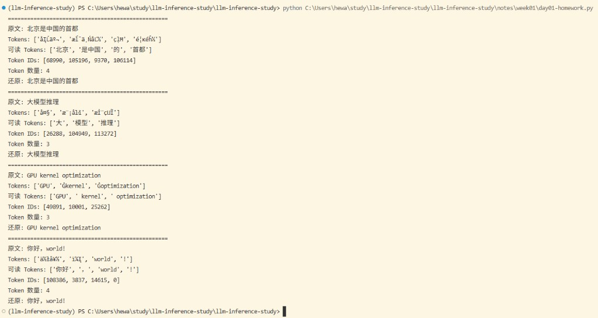

# Day 01：Token、Tokenizer、Token ID

## 今日目标

理解文本为什么必须先转换为整数序列，并观察中文、英文和中英混合文本的切分。

## 四个概念

- **Token**：模型实际处理的离散单位，不一定等于一个字或一个词。
- **Tokenizer**：把文本切成 Token，并完成 Token 与 ID 之间的转换。
- **Vocabulary**：Tokenizer 认识的 Token 集合。
- **Token ID**：Token 在词表中的整数编号。

## 学习材料

- Hugging Face LLM Course Tokenizers：https://huggingface.co/learn/llm-course/en/chapter2/4

## 实验

```python
from transformers import AutoTokenizer

model_name = "Qwen/Qwen2.5-0.5B-Instruct"
tokenizer = AutoTokenizer.from_pretrained(model_name)

texts = [
    "北京是中国的首都",
    "大模型推理",
    "GPU kernel optimization",
    "你好，world!",
]

for text in texts:
    ids = tokenizer.encode(text, add_special_tokens=False)
    tokens = tokenizer.convert_ids_to_tokens(ids)
    print("=" * 50)
    print("原文:", text)
    print("Tokens:", tokens)
    print("Token IDs:", ids)
    print("Token 数量:", len(ids))
    print("还原:", tokenizer.decode(ids))
```

## 我的结果



| 原文 | Tokens | Token IDs | 数量 | 最意外的切分 |
|---|---|---|---:|---|
| 北京是中国的首都 |  |  |  | 是中国 |
| 大模型推理 |  |  |  |大, 模型  |
| GPU kernel optimization |  |  |  |  |
| 你好，world! |  |  |  |  |

## 今日验收

- [ ] 能解释 Token 为什么不一定是一个汉字或一个单词。
- [ ] 能解释 Token ID 为什么只是编号。
- [ ] 能解释模型为什么不能直接接收字符串。
- [ ] 能区分 Tokenizer 和模型本身。

## 我的三个疑问

1. tokenizer和模型应该是配套的吧

   答案：是的，Tokenizer 决定文本怎样变成模型理解的编号；模型的 Embedding Table 决定每个编号代表什么。二者必须使用训练时约定的同一套词表、ID 映射、特殊 Token 和 Chat Template。

2. tokenizer应该是包含vocabulary吧，即又包含分词方法，又包含id编号

   答案：对，Tokenizer 是文本与 Token ID 之间的完整转换系统。它包含词表和 Token-ID 映射，也包含文本预处理、分词或字节编码规则、特殊 Token、Chat Template 以及解码规则。

   ```text
   Tokenizer
   ├── Vocabulary：Token ↔ Token ID 的映射
   ├── 分词算法：决定文本如何切成 Token
   ├── 预处理规则：大小写、空格、Unicode 规范化等
   ├── 后处理规则：添加特殊 Token、拼接序列
   ├── 特殊 Token 定义：BOS、EOS、PAD 等
   └── Decode 规则：Token ID 如何还原为文本
   ```