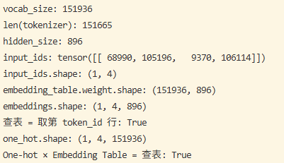

# Day 02：One-hot、Embedding Table 与 Embedding Lookup

## 今日目标

理解一次转换：`Token ID → 初始向量`。

- **Token ID 只是索引**：它是 Embedding Table 的行号，数值大小和距离没有语义。
- **One-hot Encoding**：长度为 Vocabulary Size 的向量，只有 Token ID 那一位是 1，其余都是 0。
- **Embedding Table**：形状为 `[vocab_size, hidden_size]` 的可学习矩阵，每一行是一个 Token 的向量。
- **Embedding Lookup**：按 Token ID 取出对应的行，等价于 One-hot 向量乘以 Embedding Table。
- **Vocabulary Size**：Embedding Table 的行数。
- **Hidden Size**：每个 Token 向量的长度，也是后续 Transformer 中隐藏向量的长度。

## 今日范围

```text
Input IDs                [batch_size, sequence_length]
→ Embedding Lookup（Embedding Table: [vocab_size, hidden_size]）
→ Output Embeddings      [batch_size, sequence_length, hidden_size]
```

例如：

```text
Input IDs:          [[68990, 105196, 9370, 106114]]    shape [1, 4]
Embedding Table:                                       shape [151936, 896]
Output Embeddings:                                     shape [1, 4, 896]
```

今日不展开：Logits、LM Head、Softmax、Sampling、下一个 Token 的选择、Contextual Hidden State。它们属于模型输出端，放到 [Week 02](../week02/README.md) 系统学习，文末的“我的总结”只做预览。

## 学习材料

- PyTorch `nn.Embedding`：https://pytorch.org/docs/stable/generated/torch.nn.Embedding.html

## 实验

这里的 Embedding Table 是随机初始化的，只用来观察 shape 和查表方式。真实模型的表是训练得到的，在 Week 02 的小模型观察实验中再加载。

```python
import torch
from transformers import AutoConfig, AutoTokenizer

model_name = "Qwen/Qwen2.5-0.5B-Instruct"
config = AutoConfig.from_pretrained(model_name)
tokenizer = AutoTokenizer.from_pretrained(model_name)

print("vocab_size:", config.vocab_size)
print("len(tokenizer):", len(tokenizer))
print("hidden_size:", config.hidden_size)

input_ids = tokenizer("北京是中国的首都", return_tensors="pt").input_ids
print("input_ids:", input_ids)
print("input_ids.shape:", tuple(input_ids.shape))

embedding_table = torch.nn.Embedding(config.vocab_size, config.hidden_size)
print("embedding_table.weight.shape:", tuple(embedding_table.weight.shape))

embeddings = embedding_table(input_ids)
print("embeddings.shape:", tuple(embeddings.shape))

first_id = input_ids[0, 0]
print("查表 = 取第 token_id 行:", torch.equal(embeddings[0, 0], embedding_table.weight[first_id]))

one_hot = torch.nn.functional.one_hot(input_ids, num_classes=config.vocab_size).float()
print("one_hot.shape:", tuple(one_hot.shape))
print("One-hot × Embedding Table = 查表:", torch.allclose(one_hot @ embedding_table.weight, embeddings))
```

## 我的结果



## 我的观察

- `input_ids.shape` 和 `embeddings.shape` 分别是：`(1, 4)` 和 `(1, 4, 896)`。
- 每个维度对应 batch_size、sequence_length、hidden_size 中的哪一个：
  - batch_size = 1：一次输入 1 句话。
  - sequence_length = 4：这句话被切成 4 个 Token。
  - hidden_size = 896：每个 Token ID 查表后变成长度 896 的向量。
  - 查表把每个 Token ID 换成 Embedding Table 的一行，所以 `[1, 4] → [1, 4, 896]`，只在末尾多出 hidden_size 这一维；vocab_size 不出现在输出 shape 中。
  - 同时输入两句话时是 `(2, 4) → (2, 4, 896)`，较短的句子用填充 Token 151643（`<|endoftext|>`）补齐长度。
- `len(tokenizer)` 和 `config.vocab_size` 为什么不一样：
  - `len(tokenizer)` = 151665：分词器实际使用的 Token 数，即 151643 个普通 Token（ID 0–151642）+ 22 个特殊 Token（ID 151643–151664，如 `<|endoftext|>`、`<|im_start|>`、`<|im_end|>`）。
  - `config.vocab_size` = 151936：Embedding Table 的行数。
  - 多出的 271 行（ID 151665–151935）不对应任何 Token，永远不会被查到。这样做一是让矩阵尺寸对齐到 128 的倍数（151936 = 128 × 1187），提高硬件计算效率；二是给以后新增特殊 Token 预留空间。
- 既然 One-hot 乘矩阵和查表结果相同，为什么实际实现用查表：
  1. 省存储：不用构造 One-hot 矩阵。每个 Token 的 One-hot 向量约 0.6 MB，32 个请求 × 4096 个 Token 就要约 80 GB。
  2. 省计算：One-hot 乘矩阵每个 Token 约 1.36 亿次乘加，其中只有 896 次有用；查表只是复制一行。
  3. 省内存读取（补充）：矩阵乘法要读完整张 Embedding Table（FP32 约 545 MB），查表只读用到的几行。

## 今日验收

- [ ] 能解释 Token ID 为什么只是索引，不表示大小或距离。
- [ ] 能解释 One-hot × Embedding Table 与直接查表等价。
- [ ] 知道 Embedding Table 的 shape 是 `[vocab_size, hidden_size]`。
- [ ] 能写出查表前后的 shape：`[batch_size, sequence_length] → [batch_size, sequence_length, hidden_size]`。
- [ ] 知道初始 Embedding 与上下文无关：同一个 Token ID 在任何句子中取出的都是同一行。

## 我的理解：从 Raw Text 到 Embedding

```text
Raw Text
   │  Tokenizer：按分词规则切分
   ▼
Token
   │  Tokenizer：按 Vocabulary 映射
   ▼
Token ID（Embedding Table 的行索引）
   │  模型：查 Embedding Table
   ▼
初始 Embedding（可学习的向量）
   │  后续 Transformer 层：结合上下文
   ▼
上下文相关的语义表示
```

1. **切分**：Tokenizer 先根据分词规则把 Raw Text 切成 Token。
2. **映射**：再根据 Vocabulary 将每个 Token 映射成唯一的 Token ID。
3. **查表**：Token ID 本身只是 Embedding Table 的行索引，不表达语义大小或距离。模型使用 Token ID 从 Embedding Table 中取出一个可学习的向量。
4. **形成语义**：初始 Embedding 提供 Token 的数值表示，而结合当前句子上下文的语义主要由后续 Transformer 层形成。

## 我的总结：从 Token ID 到 Logits

```text
Token IDs                               [sequence_length]
→ 查 Embedding Table
Initial Embeddings                      [sequence_length, hidden_size]
→ Transformer Blocks × N
Final Hidden States（结合上下文）       [sequence_length, hidden_size]
→ LM Head 矩阵乘法
Vocabulary Logits                       [sequence_length, vocab_size]
```

1. **查表**：Token ID 是 Embedding Table 的行索引。Embedding Lookup 在数学上等价于 One-hot 向量乘 Embedding Matrix，但实际实现直接按行取，得到 Token 的初始 Embedding Vector。
2. **结合上下文**：初始 Embedding 经过多层 Transformer，得到结合上下文的 Final Hidden State。
3. **输出分数**：Final Hidden State 经过 LM Head 的线性投影，为 Vocabulary 中每个候选 Token 计算一个 Logit。Logit 的个数等于 `config.vocab_size`（151936），也包括那 271 个空位。
4. **训练与推理**：训练阶段，Embedding Table、Transformer、LM Head 的参数通过前向计算、Loss、反向传播和优化器不断更新；推理阶段，这些参数保持固定。

### LM Head 公式

$$
\text{logits} = h W^\top + b
$$

- $h$：某个位置经过全部 Transformer 层之后的 Final Hidden State，shape `[hidden_size]`。
- $W$：LM Head 的权重矩阵，shape `[vocab_size, hidden_size]`。
- $b$：可选的偏置，shape `[vocab_size]`。
- logits：词表中每个候选 Token 的分数，shape `[vocab_size]`。

$W$ 是否就是 Embedding Table，分两种情况：

- **共享权重（Weight Tying）**：$W$ 和 Embedding Table 是同一组参数。两者的 shape 都是 `[vocab_size, hidden_size]`，所以可以共用一张矩阵。
- **不共享权重**：$W$ 和 Embedding Table 是两张独立的矩阵，各自训练。

以 Qwen2.5-0.5B 为例（Day 07 的实验可以验证）：`tie_word_embeddings` 为 `True`，即共享权重；`lm_head` 的 `bias=False`，即没有 $b$，公式简化为 $\text{logits} = h W^\top$。这张矩阵有 151936 × 896 ≈ 1.36 亿个参数，约占模型全部 4.94 亿参数的 27%，共享权重就省下了这一整张矩阵。
